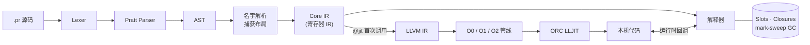

<div align="center">


# Prim

**一切皆闭包的动态语言 · 解释执行 + 手动 LLVM ORC JIT**

*closure 是静态的数据，closuring 是动态构造数据的过程。<br>对象是立即执行的 closuring，函数是延迟执行的 closuring。*

[](src/prim-rs/Cargo.toml)
[](docs/jit-runtime.md)
[](src/prim-rs/Cargo.toml)
[](src/prim-language-server/README.md)
[](src/prim-rs/Cargo.toml)

[快速开始](#-快速开始) ·
[语言速览](#-语言速览) ·
[架构](#-架构) ·
[性能](#-性能) ·
[编辑器支持](#-vs-code-语言支持) ·
[文档](#-文档)

</div>

---

## ✨ 特性

| | |
| --- | --- |
| 🧩 **统一的闭包模型** | 对象与函数同源：`@{ ... }` 数据闭包、`$[captures](params)` 可调用闭包，显式值/槽捕获与 `&` 引用参数 |
| ⚡ **手动 JIT** | `@jit` 首次调用时经 LLVM ORC LLJIT 编译为本机代码并缓存，解释器与本机代码互调；`-O0 / -O1 / -O2` 三级优化 |
| 🔍 **可内省** | 运行时查看源码、AST、Core IR、优化前后 LLVM IR、已加载机器码与反汇编 |
| ♻️ **可回收** | 非移动 mark-sweep GC，CFG 活跃寄存器作根，能回收循环引用图，附 Valgrind 审计 |
| 📚 **168 个内置接口** | stdin/stdout、文本、数学、位运算、序列、随机数、时间、文件、进程、终端绘制与按键、AST / 运行时检查 |
| 🖥️ **完整 CLI** | 持久化 REPL、重复 `-e`、`check / lex / ast / ir` 子命令、JSON 诊断、fuel / 栈深 / GC 阈值等资源限制 |
| 🛠️ **零第三方 crate** | 手写 Lexer 与 Pratt Parser，动态链接系统 `libLLVM`；无需 CMake、re2c、Bison 或外部 Clang，全程离线构建 |
| 🎨 **编辑器支持** | VS Code 扩展 + 独立 Node.js language server：语义高亮、跳转、重命名、补全、inlay hints、`.pri` 类型提示 |

## 🚀 快速开始

### 环境要求

- Linux x86_64
- Rust **1.91+** 与 Cargo
- 系统 LLVM **14** 共享库与 `llvm-config`（`build.rs` 接受 14–18，仅 14.0.0 经过验证）

### 构建与运行

```bash
# 构建 release 可执行文件 → build/prim-rs/prim
scripts/prim-rs/build.sh

build/prim-rs/prim examples/hello_world.pr                       # Hello, Prim!
build/prim-rs/prim --jit-log --stats src/prim-rs/examples/jit.pr # 观察 JIT 编译与统计
build/prim-rs/prim repl                                          # 交互式 REPL
build/prim-rs/prim src/prim-rs/examples/snake.pr                 # 终端贪吃蛇 🐍
scripts/prim-rs/demo.sh                                          # 一键跑完所有演示
```

也可以直接在仓库根目录使用 Cargo（根目录 `Cargo.toml` 是 workspace 清单）：

```bash
cargo build --release -p prim
cargo test  --release -p prim
```

> [!TIP]
> 用 `LLVM_CONFIG=/path/to/llvm-config` 指定 LLVM。可执行文件动态链接 `libLLVM-<version>.so`，运行机器需要对应共享库，可用 `ldd build/prim-rs/prim` 检查。

## 📝 语言速览

源文件扩展名为 **`.pr`**，类型接口文件为 **`.pri`**，可执行文件名为 **`prim`**。

```rust
// 构造器就是返回数据闭包的普通闭包
let Counter = $[](initial) {
    @{
        let value = initial;
        // & 捕获共享槽；@jit 让它在首次调用时编译为本机代码
        let next = @jit $[&value](step) {
            value = value + step;
            value
        };
    }
};

let counter = Counter(0);
let next = counter.next;
std.print(next(2));   // 2
counter.value = 40;
std.print(next(1));   // 41 —— 取出的方法仍持有共享槽
```

块的尾表达式即为值，`loop` 可以通过 `break` 带值返回：

```rust
let is_prime = $[](n) {
    if n < 2 { false } else {
        let d = 2;
        loop {
            if d * d > n { break true; };
            if n % d == 0 { break false; };
            d = d + 1;
        }
    }
};
```

更多语法见 [语法速查](docs/syntax-guide.md)；根目录 [`examples/`](examples) 提供 Hello World、猜数字、素数与 `.pr`/`.pri` 类型提示示例，[`src/prim-rs/examples/`](src/prim-rs/examples) 提供闭包、装饰器、JIT、内存、内省与交互示例。

## 🏗️ 架构



| 模块 | 职责 |
| --- | --- |
| [`syntax.rs`](src/prim-rs/src/syntax.rs) | Lexer、AST、Pratt Parser、源码诊断 |
| [`ir.rs`](src/prim-rs/src/ir.rs) | 名字解析、捕获布局、位置与控制目标检查、寄存器 IR |
| [`runtime.rs`](src/prim-rs/src/runtime.rs) | 动态值、环境、槽、GC、解释器与调用分派 |
| [`jit.rs`](src/prim-rs/src/jit.rs) | LLVM C API、IR 生成、ORC 编译、本机回调 |
| [`liveness.rs`](src/prim-rs/src/liveness.rs) | 基于 CFG 的活跃寄存器根分析 |
| [`session.rs`](src/prim-rs/src/session.rs) | 增量 REPL、多输入会话 |
| [`builtins.rs`](src/prim-rs/src/builtins.rs) / [`terminal.rs`](src/prim-rs/src/terminal.rs) | 标准库、termios 与按键输入、终端恢复 |
| [`main.rs`](src/prim-rs/src/main.rs) | CLI、模式与 flags、统计、执行限制 |

## 📈 性能

`@jit` 首次调用才编译，此后复用缓存；**没有**热点检测。O1/O2 下，满足条件的纯整数函数走「局部标量路径」，循环变量在优化后 IR 中成为 SSA phi，整数运算仍保留溢出检查。

<details open>
<summary><b>CPU 实测（warm 中位数，单位 ms）</b></summary>

| 案例 | 解释器 | JIT O0 | JIT O1 | JIT O2 |
| --- | ---: | ---: | ---: | ---: |
| 整数累加（20,000 次） | 5.4298 | 5.5268 | 0.0429 | **0.0372** |
| 递归 Fibonacci(18) | 3.6061 | 3.4412 | 3.4997 | 3.4446 |
| 共享捕获（5,000 次） | 2.5675 | 2.6850 | 2.6994 | 2.9692 |
| 数组求和（10,000 项） | 5.9453 | 5.5470 | 5.5342 | 6.1091 |

Intel Xeon Platinum 8558 · Rust 1.95.0 · LLVM 14.0.0 · release 构建。整数案例 O2 约为解释器的 **146×**；首次调用含约 14.6 ms 编译开销，只调用一次并不划算。捕获和数组案例未进入标量路径，收益有限。

</details>

方法、边界与原始数据见 [优化与性能测量](docs/optimization.md)，复现：

```bash
bash scripts/prim-rs/benchmark.sh 9
```

## 🖥️ CLI

```bash
prim program.pr -- script_arguments           # 运行脚本并传参
prim -e 'let x = 1;' -e 'std.print(x + 1);'   # 多段 -e 共享会话
prim --result -e '21 * 2'                     # 打印最终值
prim repl                                     # 持久化 REPL（:help :vars :reset :gc ...）
prim check program.pr                         # 只检查，不执行（另有 lex / ast / ir）
prim -O2 --stats --emit-llvm out/ program.pr  # 保存优化前后的 .ll / .opt.ll
prim --jit=off --stats program.pr             # 纯解释执行作对照
prim --fuel 1000000 --stack-limit 128 program.pr
prim --diagnostic-format=json -e '1 / 0'      # JSON 诊断
```

退出码：`0` 成功 · `1` 语言错误 · `2` 用法或输入文件错误。全部选项见 [CLI 手册](docs/cli.md)。

## 🎨 VS Code 语言支持

[`src/prim-language-server/`](src/prim-language-server/README.md) 是一个独立的 VS Code 扩展：服务端不执行用户程序，不依赖 Rust / LLVM。

- 语义高亮（构造器使用主题类型色）、TextMate 语法、light / dark 文件图标
- 定义 / 类型定义跳转、查找引用、安全重命名、悬停、补全、代码片段
- 签名提示、inlay hints、快速修复、大纲、折叠与静态 error / warning
- `.pri` 类型接口：参数 / 返回 / 字段类型、联合类型、类型别名、同名脚本关联

```bash
scripts/prim-language-server/build.sh     # 生成 build/vscode/prim-0.4.0.vsix
scripts/prim-language-server/install.sh   # 构建并安装到本机 VS Code
```

```rust
// examples/type_hints.pri —— 类似 .pyi，只描述接口
type Point = @{ let x: float; let y: float; };
let length_squared: $[](point: Point) -> float;
```

## 📂 项目结构

```text
Prim/
├── src/
│   ├── prim-rs/                 # Rust 实现：解释器、运行时、LLVM JIT、测试与示例
│   └── prim-language-server/    # VS Code 扩展与 Node.js language server
├── builtin/                     # 标准库 .pri 类型接口（types / std / jit）
├── examples/                    # 入门示例：Hello World、猜数字、素数、类型提示
├── docs/                        # 语言规范、实现设计、基准数据与计划书
├── scripts/
│   ├── prim-rs/                 # 构建、演示、基准与交互测试脚本
│   ├── prim-language-server/    # 扩展构建、校验与安装脚本
│   └── fig_logo.py              # logo 与文件图标绘制
├── icons/                       # logo 与 .pr 文件图标（fig_logo.py 输出）
└── Cargo.toml                   # Cargo workspace 清单
```

构建产物（可执行文件、`.vsix`、演示日志与导出的 IR）统一输出到 `build/`，不纳入版本控制。

## 📖 文档

| 主题 | 文档 |
| --- | --- |
| 语言设计 | [语言规范](docs/language-spec.md) — 值、槽、闭包、捕获、调用与装饰器 |
| 语法 | [语法速查](docs/syntax-guide.md) · [词法规则](docs/lexical-spec.md) |
| 前端 | [Lexer 设计](docs/lexer-design.md) · [Parser 设计](docs/parser-design.md) — EBNF、AST、名字解析与 Core IR |
| 类型提示 | [`.pri` 类型接口](docs/type-hints.md) — 接口语法、标准库声明与编辑器支持 |
| 运行时 | [JIT 与运行时](docs/jit-runtime.md) · [内存管理与审计](docs/memory-management.md) |
| 优化 | [优化与性能测量](docs/optimization.md) — 优化等级、快速路径与基准 |
| 工具 | [CLI 手册](docs/cli.md) · [内置接口（168 个）](docs/prim-builtin.md) · [AST、内省与机器码](docs/introspection.md) |
| 实现 | [Rust 实现说明](src/prim-rs/README.md) · [VS Code 扩展说明](src/prim-language-server/README.md) |
| 课设 | [项目计划书](docs/项目计划书.md) — 目标与阶段验收（实现现状以代码与测试为准） |

## 🧭 当前边界

- [x] 手写 Lexer / Pratt Parser、AST、名字解析与 Core IR
- [x] 动态类型、词法作用域、闭包 / 数据对象、显式捕获与引用参数
- [x] 条件、短路、循环、`break` / `continue` / `return`、递归与装饰器
- [x] 解释器、共享槽、循环结构 GC、标准库、源码错误定位
- [x] LLVM ORC 手动 JIT、解释 / 本机互调、整数溢出检查快路径
- [x] 持久化 REPL、可玩的终端贪吃蛇、真实 PTY 验证与内存审计
- [ ] 前端多错误恢复（当前遇错即停）
- [ ] 磁盘 / 跨进程机器码缓存（当前仅进程内缓存）
- [ ] 浮点、除余与对象操作的本机快路径
- [ ] list / dict / tuple 字面量、模块导入、运算符重载

## 🤝 参与贡献

欢迎提 [issue](https://github.com/krkawzq/jlu-cs/issues)、讨论或 PR。fork 本仓库后提交修改即可；提交前建议运行：

```bash
cargo test --release -p prim                  # Rust 实现测试
scripts/prim-language-server/validate.sh      # 扩展与内置接口校验
```

## 📄 许可

Prim 以 MIT 许可发布。

<div align="center">
<sub>由 <a href="https://github.com/krkawzq">krkawzq</a> 维护 · 如有问题或建议，欢迎通过 GitHub issue 联系</sub>
</div>
